<a href="https://nicolasfmelo.org">
  
</a>

  <a href="https://nicolasfmelo.org"><b>nicolasfmelo.org</b></a>
  &nbsp;·&nbsp;
  <a href="https://www.linkedin.com/in/nicolas-melo-bsb/">LinkedIn</a>
  &nbsp;·&nbsp;
  <a href="mailto:nicolasfmelo@gmail.com">nicolasfmelo@gmail.com</a>

<picture>
  <source media="(prefers-color-scheme: light)" srcset="assets/section-about-light.svg">
  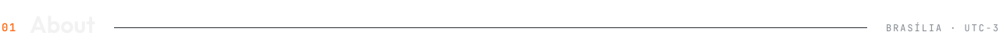
</picture>

AI engineer since 2018, taking **computer vision**, **AI agents** and **MLOps** from prototype to production. Today I work on the architecture and technical leadership of platforms running on AWS, GCP and Azure, and run [**Code Boost**](https://github.com/Code-Boost-LTDA), my AI consultancy.

Real-time detection, tracking and 3D, from Jetson to Triton. Production multi-agent platforms with RAG, LangGraph, A2A and MCP. LLMOps on Databricks, Kubernetes and observability. Critical systems — ALPR, PPE, fatigue, counting — with real-time alerts.

Before code, I was a 2nd Lieutenant in the Brazilian Army. Also around: [ShopGuard AI](https://github.com/ShopGuard-AI) · [T3 Labs](https://github.com/T3-Labs) · [Pega Placa](https://github.com/Pega-Placa).

<picture>
  <source media="(prefers-color-scheme: light)" srcset="assets/section-work-light.svg">
  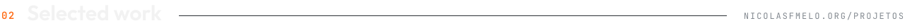
</picture>

  <a href="https://nicolasfmelo.org/projetos">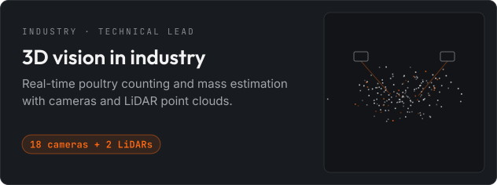</a>
  <a href="https://nicolasfmelo.org/projetos">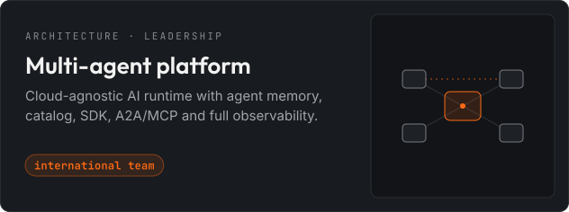</a>
  <a href="https://nicolasfmelo.org/projetos">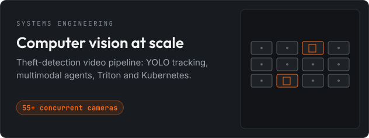</a>
  <a href="https://nicolasfmelo.org/projetos">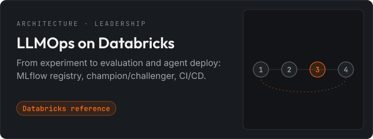</a>

30 production cases, 2018–2026 · <a href="https://nicolasfmelo.org/projetos">see them all →</a>

<picture>
  <source media="(prefers-color-scheme: light)" srcset="assets/section-building-light.svg">
  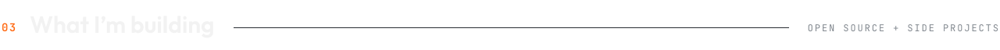
</picture>

  <a href="https://github.com/nicolasfmelo/lambda-memory">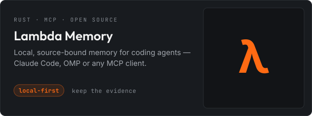</a>
  <a href="https://www.masa-framework.org/">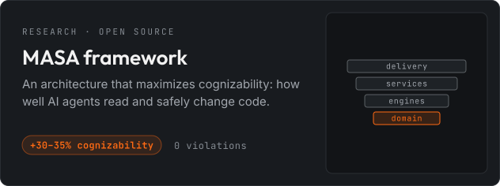</a>
  <a href="https://ergit.app">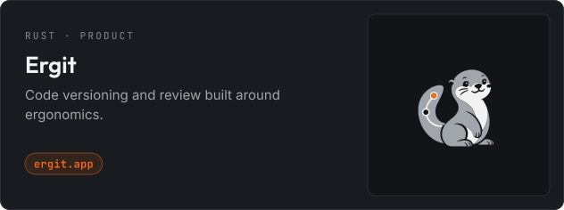</a>
  <a href="https://nicolasfmelo.org">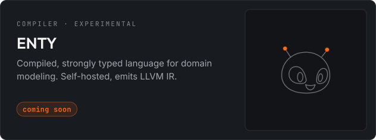</a>

  <a href="https://github.com/nicolasfmelo/lambda-memory">lambda-memory</a> ·
  <a href="https://github.com/nicolasfmelo/masa-framework">masa-framework</a> ·
  <a href="https://github.com/nicolasfmelo/masa-skill">masa-skill</a> ·
  <a href="https://github.com/nicolasfmelo/daily-taker">daily-taker</a>

<picture>
  <source media="(prefers-color-scheme: light)" srcset="assets/section-recognition-light.svg">
  
</picture>

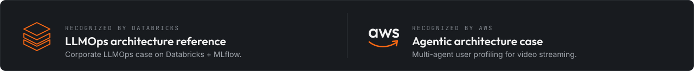

<picture>
  <source media="(prefers-color-scheme: light)" srcset="assets/section-stack-light.svg">
  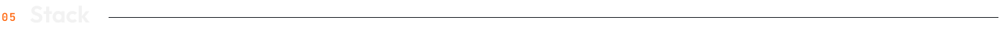
</picture>

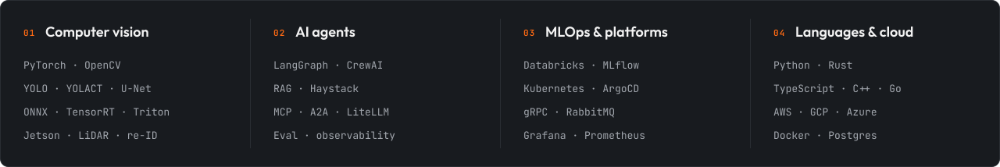

<picture>
  <source media="(prefers-color-scheme: light)" srcset="assets/section-path-light.svg">
  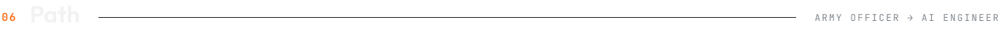
</picture>

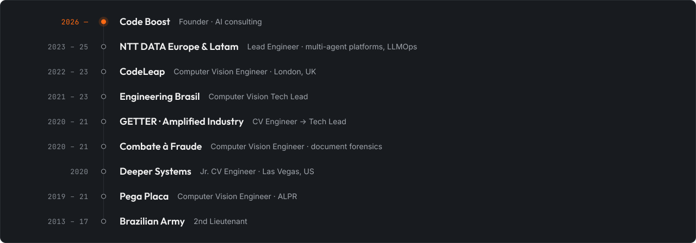

<a href="mailto:nicolasfmelo@gmail.com">
  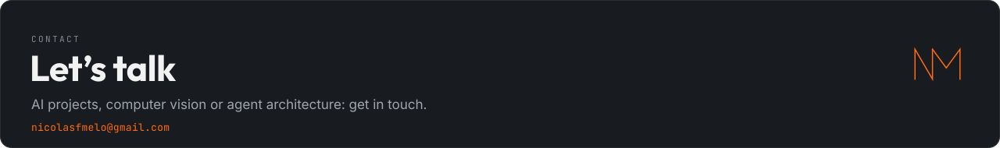
</a>

  <a href="https://nicolasfmelo.org">nicolasfmelo.org</a> ·
  <a href="https://www.linkedin.com/in/nicolas-melo-bsb/">LinkedIn</a> ·
  <a href="mailto:nicolasfmelo@gmail.com">email</a>

